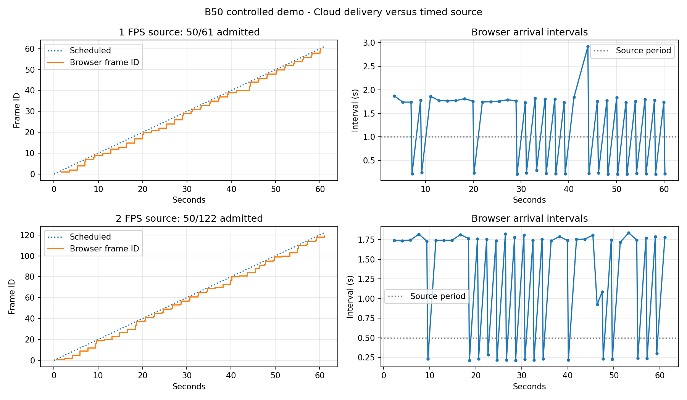

# דמו מתוזמן ואבחון קצב — XIP B50

הגרסה נצרבה דרך CDC OTA ואומתה כ־confirmed בשירות Secure. A49 נשמר כגרסה הקודמת. לא בוצע עדכון FSBL או Secure בבדיקה הזאת.

## שימוש

בטרמינל הענן:

```text
MAP ENCODING UINT8
DEMO MAP ON 1
DEMO MAP STATUS
DEMO MAP ON 2
DEMO MAP OFF
MAP ON
```

המספר הוא קצב יצירת מועדים לשנייה, לא הבטחה לקצב הקבלה. אפשר לציין במפורש `DEMO MAP ON 2 CLOUD` גם דרך USB, או `DEMO MAP ON 2 BLE` כשמחובר מנוי תמונה ב־BLE. אין תמונת ASCII של הדמו ב־USB. ברירת המחדל היא BLE לפקודה שהגיעה ב־BLE ו־Cloud לשאר מקורות הפקודה.

`MAP ENCODING RAW|UINT16|UINT8|JPEG` קובע את הדחיסה גם בדמו. JPEG מאבד מידע ועלול לטשטש פיקסל בודד; השתמשו ב־UINT8 או RAW לאבחון מדויק. הדמו מייצר מפת עומק 54×42: פיקסל אחד 3500 מ״מ, כל היתר 500 מ״מ. אינדקס הפיקסל בסריקת שורות הוא `(FRAME-1) % 2268`. הדמו עוקף עיבוד תמונת חיישן ותוצאת NPU שלו מסומנת כבויה; החיישן וה־NPU הרגילים ממשיכים לעבוד ברקע.

כל ON מתחיל מספור חדש. מספר FRAME מתקדם בכל מועד, גם כאשר התקשורת תפוסה. timestamp בפרוטוקול הוא המועד המתוכנן. אין שידור מהיר של פיגור שנצבר. תמונה שכבר הייתה בשידור יכולה להסתיים אחרי מעבר מקור. לכן משווים פערי מספרים רק בתוך ריצה אחת, לאחר תמונות המעבר.

- Scheduled: מספר המועדים שהגיעו.
- accepted: מספר הפריימים שנכנסו למסלול השידור, לא אישור קבלה בדפדפן.
- skipped: מועדים שאיחרו מעבר למחזור או שנדחו בגלל יעד לא זמין/תמונה קודמת בתהליך.
- late slots: מועדים שהמחולל עצמו החמיץ. max lateness הוא איחור המחולל במילישניות.
- cloud status / ToF sent: אישורי HTTP להעלאה. אלה אינם אישור ציור בדפדפן.

DEMO MAP OFF מפסיק את הדמו ומשחרר את יעדו. MAP ON רגיל חוזר למקור החיישן; MAP OFF מכבה גם דמו. איסוף DATASET פעיל מונע הפעלת דמו, ושינוי ליעד אחר מפסיק אותו. המנגנון אינו נשמר בהגדרות ואינו מופעל באתחול.

## מדידה חיה

בכל ריצת ענן נמדדו כ־61 שניות, בקידוד UINT8:

| מקור | מועדים | כניסה לשידור | דילוג לפני שידור | פריימים בדפדפן | איחור מקור מרבי |
|---|---:|---:|---:|---:|---:|
| 1 FPS | 61 | 50 | 11 | 49 | 18 ms |
| 2 FPS | 122 | 50 | 72 | 50 | 1 ms |

99 פריימים נצפו בדפדפן, מול 99 אישורי העלאה בלוח, ללא שגיאת בקשת HTTP חדשה. פריים נוסף התקבל למסלול אך נפל בעת עצירת/החלפת הריצה; אין להסיק מכך אובדן רשת. לא נמדדה משימת JS מעל 50ms בזמן המדידה. חציון הפער בין שינויי FRAME בדפדפן כ־1.74 שניות בשתי הריצות; הפער המרבי 2.92 שניות בריצה הראשונה.



הממצא מוכיח דילוגים לפני הדפדפן, ולא מוכיח שכל קפיצה בכל מצב נגרמת מאותה סיבה. בקוד `cloud_start_next_request` העלאת תמונה ובדיקת פקודות חולקות עובד HTTP סדרתי. כאשר אין תמונה ממתינה הוא מתחיל `waitSeconds=1`; השרת אוכף מינימום שנייה. פריים חדש יכול להמתין עד שהבקשה מסתיימת. זוהי סיבה מבנית להשהיה ומתאימה למדידה, אך לא בוצע כאן ניסוי השוואה עם שרת ששונה.

השיפור שהותקן הוא מקור אבחון מבוקר ומונים; **תזמון בקשות הענן עדיין לא תוקן**. תיקון קצב צריך לשלב בדיקת פקודות לא־ממתינה בזמן תמונה, הגבלת תדירות הבדיקות ושמירת סדר/lease/ACK של פקודות. שינוי רק ערך waitSeconds בקושחה לא מספיק: השרת הנוכחי הופך אפס לשנייה. לא שונו או נפרסו שרת/אתר במסגרת המדידה הזאת.

## אימות

- בדיקת C אמיתית: מועדי 1/2 FPS, גלישת tick, דילוגים ללא burst, כל מיקומי הפיקסל וגבולות buffer.
- 90 בדיקות codec C קיימות עברו.
- BLE אמיתי: 31 פריימים מלאים, RAW/UINT16/UINT8/JPEG וחזרה ל־RAW, אפס CRC ושברי תמונה חסרים. היו 29 פערים במספרי מועדים במהלך הבדיקה שכללה פקודות CLI; זו אינה הוכחה ל־2 FPS רציפים ב־BLE.
- אותם 31 פריימים פוענחו בקוד האתר: NPU כבוי, פיקסל גבוה במקום הצפוי, ערכים מדויקים בקידודים ללא אובדן, JPEG תקין.
- HIL חיישן: 100 tensors מדויקים, 100 תוצאות NPU תואמות, הפרש scores מרבי 0, CRC 0.
- הבנייה חתומה ומאומתת. build.json המקורי לא מנה את demo_map.h החדש שעדיין אינו tracked; hash שלו ושל יתר השינויים נמצא ב־measurements/demo-map50/summary.json. כלי הבנייה עודכן לכלול קובצי מקור לא־מנוהלים שאינם ignored בבניות הבאות.

ראיות גולמיות: `.local-dependencies/xip/demo-map50/`, אימות Secure: `confirmation-demo50-installed/result.json`, HIL: `hil-XIP-v50-timed-demo50.json`. סיכום וגרף: [summary.json](measurements/demo-map50/summary.json).

בסיום: דמו כבוי, יעד CLOUD פעיל, קידוד UINT8, תמונת חיישן ותוצאת NPU נצפו שוב באתר. חיבורי USB/UART/BLE וכלי המדידה נסגרו. הוראות הדמו נוספו גם למקור ה־Wiki באתר ונבדקה בנייתו; התיעוד באתר החי עדיין לא נפרס.
