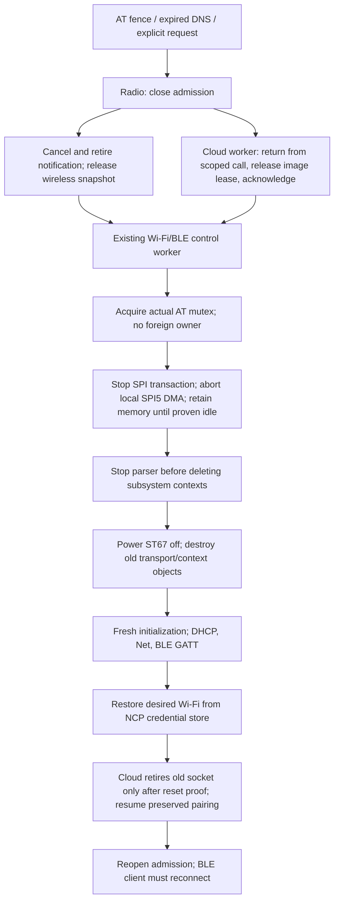

# Coordinated ST67 recovery — 2026-10-10

## Combined-load preflight blocked on Cloud authorization (2026-10-12)

The user approved the bounded sensor/Cloud/BLE CLI/DMA recovery test. No forced
fault was injected because active Cloud failed its prerequisite. Exact immutable
SRAM matches protected reader05FD9EFD...; metadata storeOK/gen1/flags31/705/
CRC72B6B9AF/writes0, saved-reference Wi-Fi IP and fence/drain/recovery0 remain
valid. Cloud stays paired but ERROR/HTTP403/transport0; accepted images stopped
6060. This does not prove loss of local pairing.

One runtime `cloud reconnect` reused existing pairing without persistent mutation
and still returned403. Dropped frames0->1 while retiring the pending lease; no
new accepted upload. Server source maps403 to device_not_allowed,409 to inactive
workspace and401 to invalid authentication. The live response body was not read:
membership is a source/status inference, not captured JSON. User was asked to
check RELAY CONNECTED and the correct updated existing workspace containing the
device. No workspace credential file, code or token payload was read/transmitted.

The first BLE failure is retained: sandbox scan saw N6-MAINT, but automatic/public/
random connections all returned DeviceNotFound before commands. Normal Windows
device access then connected transiently with pair=False/uncached GATT/MTU247.
Six real BLE PONG/final pairs pass, max125ms; OS paired flag observed, no Pair API
or new bonding request. CLI RX6 events/120 bytes, TX9 messages/1195 bytes; drops,
retries/errors0. Client and subscription disconnected on exit.

SPI5 data above8 bytes selects GPDMA1 TX channel10/RX channel11. Real BLE data
uses this verified code path; it does not prove DMA was active at a fault or
DMA abort/cancellation/in-flight reply UNKNOWN/no-replay safety. Combined HIL
is NOT RUN, not replaced by mocks or earlier separate recovery tests. Existing
soak runners' password/warm-connect/unreachable-network mutations were excluded
from this read-only preserved-settings scope.

Final ToF58337->58348/ready, Wi-Fi IP/radio available, BLE disconnected/advertising,
NCP1/1/0 unchanged, Cloud paired/403/stopped6060, drop1, USB ping PASS. COM8/BLE/
WinRT and prior COM6/SWD handles released; no active test/build. No firmware code,
build/Flash/reset/power-cut/old-file/CWCRED/HTTP/TLS/commit/push/deployment change.
No proven firmware defect justified a fix. Prior44 native/91 feature/build checks
retained, not rerun. Combined test/fulltask4 remain open pending active Cloud.

Ignored evidence: combined-preflight-20261012/inspection.json and combined-
recovery-20261012/{ble-sandbox-failure.json,ble-transient-preflight.json,
cloud-reconnect-once.json,final-health.json,terminal-summary.json}.

2026-10-11 build-only settings extension: see [unified NCP settings](unified-ncp-settings.md)
for the new guarded Wi-Fi/Cloud format and ownership integration. Writes defaultOFF,
legacy files/credentials and missing-byte blocker remain unchanged. No RAM HIL of
the new3575B8A7... candidate occurred; prior recovery checkpoints below retain their
original candidate identities and do not validate the new storage path.

2026-10-11 terminal follow-up: four controlled genuine missing-response probes
pass (`status=3 genuine_fence=1`), coordinated recovery20011/19968/20000/20792ms,
saved-credential IP return,573 CRC records/28 USB pings and no ToF recovery.
The original longer campaign FAILED on ordinary Wi-Fi loss while ToF/USB lived;
the existing control owner now restores confirmed ordinary loss with retained
saved intent, without healthy-NCP reset. User cancellation/queued work/DHCP/
unconfirmed state/true fences/owned DNS or BLE notification prevent submission;
max3 calls,10s completion cooldown, original SDK deadlines and capacities.
Two ordinary no-reset gates pass; an unsolicited loss restores with2687ms
association call, ToF/USB and NCP baseline unchanged. RF/AP/NCP cause unproven.
Eight static bytes, no new task/steady allocation; unsigned4D953D64...,
binary487952/heap383792/header9,33 native/24 feature/build-only pass. Selected
mixed-candidate ToF coverage7263.641s/22653CRC/16 faults/12 pauses passes;
original FAILED preserved, no full task4/active BLE CLI-DMA/Cloud return accepted.
Final ToF/Wi-Fi/USB/radio healthy, BLE adv/disconnected, imageNONE/Cloud unpaired;
UART2021/2021 zero drops/errors, all owned handles released. Radio max gap269ms,
BLE pump20820ms includes recovery, not latency acceptance. Strict FS bytes/CRC/
fence and UNKNOWN integrity remain; no Flash/config/auth/header/sign/package/
HTTP/TLS/commit/push/deployment. See [terminal evidence](tof-desired-state-recovery.md#longer-campaign-terminal-continuation-2026-10-11).

Tasks 3–4 are in progress. The implementation and focused hardware recovery
are present; full delivery/latency/endurance acceptance is still open. Earlier
failed reports remain evidence. Earlier candidates were RAM v10; the current
unsigned task-3 follow-up preserves header v9 and leaves Flash unchanged.
No CubeMX generation is required, and no queue, stack, radio pool or image
snapshot capacity was increased.

## Cloud startup investigation - 2026-10-10

### Saved-pairing follow-up and terminal blocker, 2026-10-11

Reconciled the existing dirty `ble` checkout at `d89a510` with the healthy
unsigned4D953D64... RAM checkpoint. No competing Python/HIL/programmer/build
process was found. No firmware implementation changed in this follow-up: the
current production read already requires all1172 original bytes, original
whole-record CRC/schema, one original2000ms scope, output retirement and a
retained genuine fence. It neither repairs nor deletes a failed saved record.

The logical command matches the official host1.3.0 implementation and
[NCP2.0.106 FS semantics](https://applist67.github.io/Web_AT_Documentation_ST67/v2.0.106/index.html#at-fs):
type0/LittleFS, operation3/read, filename, offset and length. Both request and
reply use the AT traffic queue0; no documented separate FS binary channel or
logical hex/checksum operation was found. The previous public-offset5 probe
already saw an empty13-byte reply before buffer pull/resize, with exact host
copy. No new saved-file payload read or reconstructed-byte experiment was run.

Added `hil_tests/test_spi_fs_framing.py`, which compiles and executes the actual
`spi_xfer_one`, header validation and buffer helpers. Mocked byte transfers feed
the header-first/remaining-transfer paths, alignment and short-buffer resizing.
Real-NUL14-byte and absent-payload13-byte public replies remain distinct across
11 TX sizes. Another132 TX/RX length combinations preserve all256 byte values
through the1520-byte MTU. Two failed small-buffer allocations retain exact
original packets; two transfer failures publish no partial packet and release
RX only after successful local abort. All158 scenarios pass. This is host
framing evidence, not DMA/electrical/NCP-storage proof. An initial test-harness
preprocessor newline failure was corrected; its failed log is retained.

The three actual-C parser/lifetime/pairing regressions also pass, including
strict empty+OK rejection,32-bit length, original CRC and actual nonzero
tails/padding. No new firmware build/feature matrix was required or run; prior
33-native/24-feature/build results apply to the unchanged exact ELF, not to a
new candidate. Only the four focused host test files were run in this follow-up.

**Smallest remaining blocker:** a validated NCP2.0.106 binary-safe logical-file
read/response contract that supplies the complete original record. An independent
NCP-local CRC can resolve storage integrity but cannot alone load the missing
pairing bytes. Current AT FS omits a declared public byte; size/partition/command
availability metadata cannot supply or certify it. `AT+CMD?`/`AT+PART?` were not
run: discovering command names/layout does not provide a validated logical read
encoding or safe physical-file mapping. The generic vendor AT API exists but no
raw AT path is exposed by this application. No temporary interface/RAM reload
was added merely to repeat metadata that cannot resolve that dependency.
Physical FLASH-R-HEX mapping, lock permission and credential exclusion remain
unknown. No raw Flash read, address guess, unlock, credential/token transfer,
record mutation, re-pairing or ST contact occurred. The separate FAE project was
not touched. Requesting the vendor's logical FS binary response specification
or corrected implementation is the next useful dependency; no action has been
sent on the user's behalf.

Connected Cloud -> genuine NCP fault -> restored Cloud HIL is **BLOCKED / NOT
RUN** because the board remains unpaired. A fault test on that state cannot
accept connected Cloud restoration; prior Wi-Fi recovery passes remain valid.
Final read-only status: ToF114793->114834, ready, recovery8/8/0/gen8 unchanged;
Wi-Fi IP ready, USB/radio ready, BLE advertising/disconnected, imageNONE,
Cloud unpaired, NCP recovery3/3/0 unchanged, SPI faults/allocations0,
UART7085/7085 zero drops/errors. The collector closed COM8; no COM6/debugger was
opened and no test/build process remains. WMI process enumeration was denied;
ordinary process enumeration completed without those active processes.
Current ELF and retained candidate hashes both remain
`4D953D643096FFF95E7013FEB21E311220C7D0622783EB6A9C4B3CA914B962C6`.
Header9/Flash unchanged; no signing/package, HTTP/TLS, commit/push/deployment
or task4 endurance work. Evidence and failed fixture log are under ignored
`.local-dependencies/diagnostics/cloud-fs-resume-20261011/`.

### Official read-only diagnostic lead, 2026-10-11

The [official ST wiki](https://wiki.st.com/stm32mcu/wiki/Connectivity:ST67W611M_AT_Command)
links to the version-specific
[ST67 AT2.0.106 documentation](https://applist67.github.io/Web_AT_Documentation_ST67/v2.0.106/index.html#at-flash-r-hex).
`AT+FLASH-R-HEX=<nbytes>,"<address>"` is documented to return hexadecimal data
for1..8192 bytes at a physical Flash address. `AT+CMD?` lists supported command
types, and `AT+PART?` returns partition names, addresses, lengths and update
metadata. These are availability/layout leads, not a logical-file reader.

The documentation does not establish this device's lock-state permission, a
safe logical LittleFS filename/offset-to-physical mapping, or exclusion of
credential material from a physical range. Partition metadata cannot identify
the current file blocks or establish that they are safe to inspect. No
independent FS checksum command was found in the inspected command reference.
The FS section documents logical LittleFS operations but supplies no validated
binary/hex read encoding that explains the existing absent-NUL response.
Device availability/partition queries were not executed: this exact application
has no exposed raw-AT menu path; the vendor shell/API exists in source but is
not the application's CLI. Adding a temporary raw interface does not solve
file mapping or credential exclusion. No raw address was guessed/read, no
unlock/security/provisioning command was issued, and no credential dump occurred.

The local host driver identifies as1.3.0, and UART reports NCP SDK2.0.106.
[ST's V1.3.0 release notes](https://github.com/STMicroelectronics/x-cube-st67w61/blob/main/Release_Notes.html)
include P67W61-738, an SPI TX-length versus allocated RX-buffer overflow fix.
The current AT bus caller uses `SPI_MSG_OP_DATA`; `spi_write` bounds its data
length to the MTU, RX allocation includes that MTU plus the SPI header, and
peer-header length is checked against the same MTU. Those checks also appear
in the local vendor1.3.0 source. This is a source/version comparison, not a
reproduction of every overflow path or proof that the historical defect never
occurred. The public FS probe's received13-byte packet and exact host copy do
not establish a causal connection to P67W61-738. Its relevance remains unproven;
the missing NUL is still an upstream malformed response at the observed boundary,
with stored-record integrity UNKNOWN.

The strict exact-byte count, original whole-record CRC/schema, original2s
budget, borrowed-output retirement and genuine fence remain unchanged. The
next useful evidence is ST's binary FS response implementation/validated
encoding, an independent on-NCP checksum or binary-safe logical-file read,
or a vendor-established safe mapping/security contract. None is supplied by
partition metadata alone. Cloud pairing/restoration remains blocked; no saved
record repair/re-pairing, HTTP/TLS change or Flash operation is justified.
Downloaded official HTML, its hash/provenance and the comparison notes are
retained under ignored `.local-dependencies/diagnostics/tof-longer-20261011/`
(`st-at-2.0.106.html`, `st-fs-lead.json`).

### SPI-boundary diagnosis and strict binary fix (latest)

Earlier conclusions about an invalid **stored** record are withdrawn. The legacy
reader and tail audit inferred NUL from empty+OK and, initially, guessed string
tails. A CRC failure over those transformed values does not distinguish corrupt
storage from a corrupt/undefined read representation. The143 nonzero-tail count
and failed CRC are retained observations of that decoder, not an independent
filesystem integrity check. No claim of stored-file corruption is justified.

A bounded, public-offset-only RAM probe locates the missing byte before host
parsing. Expected ST-LINK and no competing HIL/debugger were checked; the healthy
39116974... board snapshot/ELF was saved before reset. The probe examined only
file offset5, the version-high byte expected to be NUL0x00 for a valid version1
header. It did not examine credentials or expose file values. Before SPI buffer
pull/resize/queue publication, it compared the received AT packet against fixed
public response shapes and recorded peer header length. After the retained-packet
copy, it recorded byte-for-byte equality; at the direct callback it classified
the accumulated buffer. Formatting occurred only in the FS caller; SPI/RX code
captured scalar flags without allocation or formatting.

Exact RAM observation:
`peer_len=13 raw_seen=1 raw_len=13 raw_empty=1 raw_nul=0 copy_seen=1 copy_equal=1 parser_seen=1 parser_len=19 parser_empty=1 parser_nul=0`.
The received packet is11 bytes of `+FS:READ,1,` plus2 delimiter bytes; there is
**no payload byte**, although the FS response declares1. The parser later has
those same13 bytes plus6 bytes of terminal OK. Host copying did not delete NUL.
The defect is a malformed binary FS reply **as received at the SPI boundary**,
upstream of host parser interpretation. The probe did not capture electrical
signals or NCP filesystem internals: it cannot prove the actual stored byte,
the NCP's formatter implementation, or whether storage itself is intact.
The expected NUL refers to value0x00 at offset5, not a byte at offset0.

The proven host defect was accepting a delimiter as the missing byte, followed
by an unvalidated empty-to-zero workaround. Both are closed: complete empty+OK
now reports an error, leaves output untouched and fences admission. No inferred
zero, tail or padding can become pairing data. A returned terminal cannot clear
the fence. The original single2000 ms binary read, complete copied-length proof,
output-pointer retirement and full original CRC/schema validation remain. The
FS declaration is32-bit so65544 cannot wrap to8 and be falsely accepted.
Production reads all bytes exactly or scrubs volatile output and rejects the
load; it neither rewrites nor deletes the saved record. Temporary SPI/copy/parser
probe code was removed after capture; ordinary SPI transport is unchanged.

Native regressions execute the actual retained SPI-to-parser read, explicit
collector count and direct FS callback using synthetic packets. Embedded NUL,
all256 byte values and33 destination-room boundaries preserve every byte and
packet ownership; empty+OK is rejected. These tests do not emulate DMA or NCP
storage. Pairing tests require exact complete binary data, preserve arbitrary
actual tail/padding bytes, check original CRC/schema and scrub every partial
failure under one original budget. All31 native files/16 feature compiles/build
pass. Final unsigned ELF:
`31010048FB2DCA41377E34FC702E6836F69EE8659C127B30F6A455BA07BB0B70`;
binary486632, heap385112 (minimum368640), header9. FS caller frame288/callback40
bytes are compiler frames, not worst-stack proof. No capacity/task/steady-state
allocation or HTTP/TLS budget change. Earlier failed native test-fixture setup
attempts remain in the ignored evidence, followed by passing retests.

Probe ELF4A1DE821... rejected the malformed response without changing the output;
genuine fence recovery15977 ms completed while ToF frames advanced. Cloud remained
unpaired. Clean final RAM reload then reproduced the known warm ToF I3C dynamic-
address startup failure (frame0). The full FS read recorded declared1172,
assembly27/copied0, original2000 ms timeout/fence1, and no reconstructed input.
USB/Wi-Fi remained usable: five pings and saved-credential IP restore recorded,
but this failed sensor boot is not a full recovery/latency PASS. Short firmware
recovery timings214/386 ms from this warm boot are not promoted to acceptance.
Last captured board: final31010048... RAM, radio/USB ready, Wi-Fi IP, BLE
advertising/disconnected, imageNONE, Cloud unpaired, ToF error/frame0. All host
handles released. Full physical power removal/reconnect requested to restore a
healthy sensor boot; confirmation pending, existing RAM permission valid.

**Terminal diagnostic blocker:** AT FS is the sole available local view of the
saved file, and it has just demonstrated missing binary data. Repeating its
reads, using its size query, rebuilding CRC over inferred bytes, or re-pairing
does not distinguish storage from the read defect. Need an independent on-NCP
file CRC32/binary-safe read interface, or ST's FS read/response implementation/
validated binary encoding for NCP2.0.106. It can return only integrity metadata;
credential disclosure is unnecessary. If physical transport is disputed, a
logic-analyzer capture of this same public offset can independently confirm the
received frame. No documented empty-to-NUL encoding or independent file checksum
was found in the available host SDK. ST publishes NCP images in its
[binary package](https://github.com/STMicroelectronics/x-cube-st67w61/blob/main/Projects/ST67W6X_Scripts/Binaries/README.md);
host code is not evidence of the closed NCP formatter. No configuration repair,
re-pairing or NCP flashing is justified by this evidence or authorized here.

Cloud restoration remains blocked/unverified. No persistent credential/config/
auth/Flash/header write, provisioning, HTTP/TLS modification, signing/package,
commit/push/deployment or endurance run occurred. Evidence:
`.local-dependencies/diagnostics/task3-fs-boundary-20261010/`.

### Earlier legacy decoder/audit checkpoint (superseded)

### Final legacy RAM validation and stored-record audit

The inferred-byte audit below cannot establish actual stored contents or stored
CRC corruption. Its conclusions are limited by the latest SPI-boundary finding.

The second physical power cycle was confirmed by the user. No competing HIL or
debugger was active. Expected ST-LINK000C00344142501620353451 was identified;
approved RAM loads reached ThreadX with no external-NOR programming. The logger
initially found no `serial` in the default Python314 runtime; switching to the
existing `training/.venv` succeeded before loading RAM, so no boot capture was
lost. Dirty `ble`/d89a510 and unrelated edits/processes were preserved.

The previously omitted byte is the **NUL value0x00 at file offset5** (the sixth
magic/version byte), not a byte at offset0. Five/six-byte public-header probes
and the one-byte offset5 probe locate the failure in the binary FS-read path.
The old `on_cmd_fs_readfile` accepted a CR delimiter as a one-byte payload;
whole-record reads instead waited for bytes that never arrived. The host SPI/RX
path uses explicit packet lengths and `memcpy`, not `strlen` for payload. This
supports an NCP FS-output limitation; no raw electrical SPI capture or NCP
firmware source was inspected, so the internal NCP function/cause is unproven.
It precedes HTTP/TLS work.

Exact first legacy candidate1E4B968F... completed329 one-byte reads within its
original2000 ms scope and ToF was ready/advancing, but pairing was rejected.
Boolean-only diagnostics establish magic/version/length/terminated strings all
valid, **CRC invalid**. The reader now reads the ABI padding/footer exactly
(330 reads), retaining canonical-zero string tails and the original CRC/schema.
Padding was not the cause: CRC still failed. Final unsigned ELF is
`39116974A8322069A7D0939EFBEC9171127BA09FE8CD0FA342F637E8A85B573F`;
binary486808/C heap384952 (minimum368640), unchanged header9. All30 actual-C
files,16 feature compiles, build/memory contracts pass. A nonzero ABI padding
fixture is preserved exactly; corrupt/noncanonical string tails still reject.

A temporary on-device diagnostic then read all842 skipped string-tail bytes,
in separate bounded read-only audit requests, after the failed restoration.
Together with330 original reads, all1172 file bytes were examined inside the
firmware, with no file values/token/credentials exposed to host tools. Metadata:
`result=0 calls=842 nonzero_tail_bytes=143 full_crc_ok=0 stored_crc_nonzero=1`.
Thus the complete record **as returned by FS** fails the existing version1 CRC,
even without assuming zero tails. This is not proof of where/when storage or
NCP output became incorrect. No attempt was made to repair/rewrite the file or
accept a weaker checksum. The extra audit did not admit pairing or renew the
production restoration budget. Its source/ELF/UART are retained; temporary code
was removed, and the final rebuild reproduces the exact39116974... ELF.
Audit ELF: `C4169C8F6C068BC20DA850C7D2DC57A5F200EF925F604D51481B9CB34C0CC58D`.

Focused recovery on the final39116974... image passes independently of the
unpaired Cloud state: RAM-only non-secret desired-SSID/connection intent fixture
after MCU reload uses existing NCP credentials, with no password/CWCREDADD or
stored configuration write. Explicit recovery17781 ms/20 USB pings restores IP.
Connected-BLE genuine missing-response injection recovers in19969 ms (firmware
19511), with23 USB pings and advancing ToF frames3247/3292/3336/3381/3425/3462.
Automatic saved-credential Wi-Fi restoration passes; host sends no connect or
password. All38 BLE finals arrive, p95/max156 ms,13 CRC-valid BLE images,
one interrupted assembly at recovery, zero CRC errors. Actual sequence2 UNKNOWN
notice received; active_reply=0, so in-flight-command HIL remains open. No natural
SPI fault or allocation failure observed. SetConnParam status2 observations are
retained; this is not zero-driver-error acceptance. Radio max gap21 ms; BLE pump
gap19537 ms includes recovery and must not be presented as ordinary21 ms latency.

Cloud pairing load is **FAIL**, and actual server-received images/Cloud restoration
are **NOT RUN/blocked** by the invalid FS record. IP readiness, completed reads,
BLE images or a successful reset do not close this gate. Broader endurance,
DMA-abort/partial-init fault HIL and worst-stack claims remain outside this run.
Flash/header, credentials/configuration, HTTP/TLS, signing/package, provisioning,
commit/push/deployment were unchanged. Current evidence and final-board capture:
`.local-dependencies/diagnostics/task3-cloud-legacy-20261010/`.

Final cleanup reload runs the exact39116974... image with the audit removed.
RAM-only Wi-Fi intent restoration completes18610 ms/21 USB pings (firmware
17430 ms; saved-credential association2617 ms). Final capture: ToF ready with
frames1295 then1321, Wi-Fi IP, BLE disconnected/advertising, image NONE, Cloud
unpaired/HTTP inactive. UART195/195, zero dropped/errors in this final boot
snapshot; this does not erase prior driver errors. COM6/COM8/BLE/debugger handles
released, with no remaining Python/GDB/programmer test process. No further board
availability approval is pending. A valid saved pairing source is required for
the remaining Cloud gate; no configuration repair/re-pairing was authorized here.

### Earlier cold follow-up (retained)

### Cold follow-up and read-only legacy candidate

The user confirmed a full physical power removal/reconnect. ST-LINK recovered,
and sliced candidate `75525ECB0DC9D084CBE5F5BE756CF85977102114093BDD401B6A8A2F5F02FE69`
was loaded into RAM. ToF initialized and continued producing frames. The first
256-byte FS read still failed: declared256, assembly26, copied0, elapsed2000 ms,
fence1. Automatic coordinated AT_FENCED recovery completed in15199 ms while ToF
continued. **Slicing did not fix pairing restoration**; Cloud remained unpaired.
The earlier blocked-USB checkpoint below is historical, not the current blocker.

A temporary diagnostic used only the six public magic/version bytes. Reads of
five and six bytes both returned assembly18; the first five matched, but the
sixth expected NUL did not. Reading only that NUL returned declared1/assembly13
and the old callback copied a response delimiter. Only validity booleans and
lengths were logged; no file payload, token or credential was inspected by host
tools. This proves binary round-trip failure for NUL in this NCP FS response.
The NCP's internal implementation remains an inference, not inspected source.
The temporary probe was removed; its ELF/source/UART evidence is retained.
Its warm RAM reload reproduced the known ToF I3C dynamic-address failure.

The replacement candidate reads each meaningful byte of the existing version1
record. The driver decodes an omitted NUL only from a complete, declared-one-byte
empty record followed by correlated OK; partial responses/timeouts never imply
zero. It leaves OK to the ordinary terminal owner. Real CR/LF/NUL/non-ASCII bytes
are distinguished using the payload delimiter. The existing writer zeroes string
tails/padding, so the reader reconstructs them in existing storage, then requires
the original whole-record CRC and schema/length checks before accepting pairing.
An unexpected tail/padding, unterminated string, timeout or corrupt CRC fails
closed and scrubs volatile state without deleting the saved file. One original
2000 ms scope covers the byte reads; it is never renewed per byte. The size query
retains its existing separate operation. Save verification reuses the reader;
no persistent write path or file format was changed or exercised on hardware.
Successful one-byte scalar logs are suppressed to avoid flooding UART; failures
and aggregate read status/call count remain visible, without payload values.

Actual-C regressions cover both empty-record forms and every partial boundary,
real delimiter/binary bytes, ERROR without OK, original CRC, enabled intent,
invalid schema/strings/tails/padding, every partial failure and one shared budget.
The build passes: binary486464, C heap385304 (minimum368640), header9; unsigned ELF
`1E4B968FE2A3EDAB913529EAD62A350B4042ABDBB21EB5573FCB1BD520997A47`.
Compiler frames are FS caller288, callback64 and legacy reader48 bytes; these
are individual frames, not worst-stack proof. No new buffer/task/capacity or
steady-state allocation was added. This legacy candidate has **not been loaded**.
All30 native test files and16 feature-mode compiles pass, with zero failing files.
`git diff --check` passes (existing CRLF conversion notices only). Focused RAM
validation of this exact legacy candidate remains NOT RUN; Cloud restoration is
not accepted. Native compiler conversion/deprecation warnings and the existing
linker RWX warning are retained in logs, not silently presented as warning-free.

The final captured hardware state is the header-probe RAM image: radio/USB ready,
BLE disconnected/advertising, Wi-Fi disconnected, Cloud unpaired, image NONE,
ToF dynamic-address error/frame0. A second full physical power removal/reconnect
was requested for a healthy cold RAM test; confirmation is pending. Existing RAM
approval remains valid. All UART/USB/debugger handles were released. The transient
execution-environment disconnect occurred between tests, with no active HIL/build;
it invalidated no completed hardware result. A later read-only enumeration again
identified the expected ST-LINK. No Flash/header/authentication/configuration write,
re-pairing, HTTP/TLS change, signing/package, commit/push or deployment occurred.
Evidence: `.local-dependencies/diagnostics/task3-cloud-cold-20261010/`.

### Earlier diagnostic/slice checkpoint (retained)

This follow-up was authorized to diagnose the unresolved startup pairing-file
read without reading credential values through host tools, re-provisioning,
changing saved configuration or expanding HTTP/TLS/endurance scope. Existing
RAM reset/load approval remains valid. The dirty `ble`/d89a510 checkout was
preserved; no other Python/GDB HIL process was active at the initial check.

Diagnostic firmware adds only FS callback count/length scalars; formatting is
in the calling task after the operation, never in SPI/IRQ/parser callbacks.
The approved RAM load reached ThreadX. On this repeated startup, the file-size
query succeeded and requested read length was1172. UART records:
`result=3 elapsed_ms=2000 requested=1172 callbacks=2 declared=1172 available=27 copied=0 fenced=0`.
These are metadata only; the payload was never logged or dumped. Startup ignores
the failed load result, clears volatile pairing and marks Cloud initialized,
so a transient file-load failure cannot be retried via the current reconnect
command. The response assembly is incomplete; the evidence does not yet settle
whether NCP file-output limitations, binary truncation or another transport
issue caused the missing bytes. It is not evidence of an HTTP/TLS timeout.

The candidate follows the existing SDK file comparison's256-byte reads instead
of requesting the entire record at once. One existing2000 ms request scope
includes all slices, without a fresh budget per chunk or additional buffers.
The record is assembled in the existing destination, then passes the original
length/schema/CRC validation. A partial failure scrubs only the volatile record.
The same reader is used for save verification; the persistent write path and
record format were not changed or invoked during this work.

FS read now publishes the expected output length, rejects a mismatched complete
payload, requires copied-length proof even after OK, and retires the borrowed
pointer before releasing AT ownership. Submitted unanswered reads fence the
transport; pre-write timeouts and definite ERROR do not create a false fence.
A true fence is never cleared here. No new task, steady-state allocation,
buffer/queue/stack capacity or HTTP/TLS budget was introduced; diagnostic scalar
metadata uses16 bytes.

All30 `hil_tests/test_*.py` files and16 feature-mode compiles pass. New actual-C
tests cover4x256+148-byte binary assembly, shared-budget expiry, partial-failure
scrub, FS output retirement, late callbacks, wrong lengths, missing payload and
raced terminal OK. Build/link/memory contracts pass: binary486216 bytes,
C heap385528 (minimum368640). FS caller compiler frame280 bytes, callback40;
these are individual frames, not worst-stack proof. Existing linker RWX warning
and native legacy numeric-conversion warnings remain recorded.

The proposed fix has **not** been validated on hardware. Its next loader failed
before SRAM replacement with `DEV_USB_COMM_ERR`; read-only programmer enumeration
also failed with no probe identity, including approved normal device access.
No other GDB server was left running. A full board power removal and ST-LINK USB
reconnect was requested; no user confirmation of that physical action arrived
during this checkpoint. This is the immediate blocker, not a new RAM/pairing
permission request. Do not claim sliced reads fix the file-read failure or that
Cloud was restored.

Identities:

- Loaded diagnostic ELF:
  `B6C38878DCC0A75D0AF4519E3F0EA5FDE03A04155FFC98AABE61E9046F180974`.
- Built/unloaded slice/lifetime candidate:
  `75525ECB0DC9D084CBE5F5BE756CF85977102114093BDD401B6A8A2F5F02FE69`.
- Both preserve version header9. The external Flash v9 installation was not
  changed; a changed RAM program reporting9 does not mean it was Flash-installed.

Final USB capture: radio/USB ready, BLE disconnected/advertising, Wi-Fi
disconnected, Cloud not paired, image NONE. The diagnostic warm RAM reload
reproduced the already documented ToF I3C dynamic-address startup failure
(frame0), independently of the proposed sliced reader. Sensor/Cloud image HIL
cannot proceed in this state. COM6/COM8 logger/CLI and debugger handles were
released. No credential values were inspected, no new authentication/pairing
performed, and no saved file, Flash/header, provisioning, signing/package,
commit/push or deployment operation occurred. Restoring normal Wi-Fi/ToF state
still requires the blocked cold RAM reload and prior non-secret intent fixture.

Ignored evidence: `.local-dependencies/diagnostics/task3-cloud-20261010/`
contains diagnostic build/ELF/load/UART, failed sliced load and its unrelated
old-board UART, candidate ELF/build, native results and individual logs,
feature results, final USB status and summary. The earlier exact-ELF successful
focused recovery remains valid for its checkpoint and does not validate this
new candidate.

## Task 3 host follow-up - 2026-10-10

The checkout is `ble` at `d89a510`, with the coordinator, desired Wi-Fi restore,
SPI/parser stop checks and Candidate F diagnostics already present as dirty
work. No local `.agents/skills` directory was found in this checkout or its
examined ancestors. No Python HIL, compiler or ST-LINK process was active at
inspection; CIM command-line enumeration was denied, so unrelated Node tasks
were left untouched. The prior F hour report and its cleanup runner already
exist with `passed=true`/`test_exit_code=0` and verified Cloud return. Those are
previous-candidate evidence; no task 4 profile was started or rerun here.
Older pending-hour notes below describe the earlier checkpoint and do not
validate this changed build.

Two gaps were reproduced using actual pre-fix C in a temporary host harness:

- A late old-parser CONNECTED record revived the retired BLE generation;
  a following old ToF CCCD record could change the exclusive image route.
  Recovery now ignores old-parser events until teardown finishes. During
  fresh initialization, new connection/MTU/subscription observations remain
  accepted for automatic client reconnection, while writes and application
  RX/TX/reply admission stay closed until restoration completes. A failed
  recovery keeps all of these admissions closed.
- Uptime zero was used both as a valid START time and an unstarted sentinel.
  With an owner still pending, START and Cloud pause repeated at the next
  Radio pass and moved the original deadline. The existing lifecycle stage
  now marks START; a request resets that stage explicitly. A 35 s wait starting
  at HAL tick 0 fails closed on its original deadline.

Reply reservations recheck recovery and generation after acquiring the existing
slots, then return all slots if admission changed. Direct TX retains the
original generation across its bounded slot wait, and cannot label old output
with a replacement link. RX rechecks after dequeue and returns a raced slot
before delivering bytes to the parser. Old reply final publication is rejected
even in the interval before Radio advances the generation. No new task, queue,
buffer, steady-state allocation or time budget was introduced. HTTP/TLS and
the companion web project were not changed in this follow-up.

Verification: all 28 `hil_tests/test_*.py` files pass, including the new
`test_ble_recovery_barrier.py` and additional reply-lease/dequeue/tick0 races.
All 16 existing feature-mode syntax checks pass. The supported
`Tools/Build-NonSecureIncremental.ps1` build/link and image/memory contracts pass:
Non-Secure binary 485504 bytes; C heap 386280 bytes, above 368640 minimum.
The linker still emits the existing RWX LOAD-segment warning. First native/build
attempts failed because compiler child processes could not use the sandbox TEMP
directory; retrying with process-local TEMP/TMP in workspace `tmp` succeeded.
GCC callback frame 32 bytes, reply reservation 96, stream read/write 56,
coordinator 176; these are individual compiler frames, not worst-stack proof.

Build-only ELF SHA256
`DC3BC6DD3539E1BE51C4C2C42E5BC137321A604B858F75B5812BECC9D12E5928`;
binary SHA256
`8D3D3F0326B05826B9B955369B1D5B6342F4A496FB74BB962F25F0B1220D2998`.
Tracked header 9 is unchanged. At the host checkpoint this build was neither
signed nor loaded; the approved RAM follow-up below now verifies this exact ELF.
Prior saved RAM F/v10 evidence does not validate these changes. No signing,
package, Flash/version change, provisioning, commit, push or deployment occurred.
No Generate Code is required for this follow-up.

Ignored evidence directory: `.local-dependencies/diagnostics/task3-review-20261010/`
contains `before-fix.log`, `native-results.json` and per-test logs, `build.log`,
retained `build-temp-failure.log`, `feature.log`/`feature-modes.json` and exact
build identity. Focused RAM HIL subsequently received explicit user
board-availability approval; the results and limits follow.
The natural SPI fault cause, older failed checkpoints and full acceptance gates
remain separate open issues.

## Task 3 focused RAM follow-up - 2026-10-10

The exact host-tested ELF above was loaded with
`Tools/Debug-NonSecureRam.ps1 -NoBuild -Run`; both vectors were checked and
ThreadX reached before debugger detach. No firmware change was needed during
HIL. UART/USB report firmware 9 because the tracked header was preserved;
this unsigned RAM load is separate from prior signed v10 candidate history.
No Flash operation, credential provisioning, package generation or deployment
was performed.

MCU reload intentionally clears volatile desired Wi-Fi intent. This test seeded
only the non-secret SSID and two existing intent/credential-present scalars in
SRAM through SWD, after verifying their exact ELF addresses and SRAM bounds.
The saved SSID was obtained from prior evidence. No password was read or sent,
and no CWCREDADD was issued. This fixture verifies restoration using already
stored NCP credentials; it does not repeat the successful user-connect/store
path. The initial explicit recovery passed in 18542 ms, with 21 USB pings.

With BLE CLI and ToF notifications connected, `radio fault-test` first closed
admission and waited for owners, then powered down NCP and issued the existing
bounded AT diagnostic. UART records `status=3 genuine_fence=1`. Recovery passed
in 21104 ms (host 21812 ms), Wi-Fi restored in 2665 ms with IP and without a
host connect/password command. USB 25/25 pings passed; sampled sensor frames
4594, 4639, 4682, 4727, 4769, 4815, 4826 advanced throughout. Windows restored a
fresh connection during init. The sequence-2 UNKNOWN/no-replay event was received
on the old client's restored subscription and retained alongside the subsequent
manual reconnect. 38 BLE CLI finals passed, p95 nearest-rank 172 ms/max 203 ms,
including 20 after reconnect. At least five CRC-valid BLE frames passed before
and after; 15 complete frames total, zero CRC errors. Two interrupted host frame
assemblies are retained across reset/subscription transitions.

The independent focused exclusive-route gate passed five BLE frames, five USB
dataset records and five further BLE frames, all CRC-valid. BLE packet counts
were 260 at both the first and last complete USB frame; a prior frame drained
during the initial handoff and one interrupted assembly was retained. Final
route NONE, Wi-Fi IP, BLE disconnected/advertising, ToF ready. Allocation failures
and CLI RX/TX drops were zero; UART 481/481, no drops or HAL errors. Driver errors
were not zero: initial filesystem TIMEOUT plus four SetConnParam status=2
observations are retained. SPI natural-fault count remained zero.

Two host attempts failed before any BLE command/fault injection because WinRT
could scan but could not open the device inside the sandbox. Both reports are
retained. Approved normal WinRT device access then passed both connections with
neutral automatic address type; no firmware workaround was made. COM6/COM8,
BLE and ST-LINK/GDB handles were released; both COM ports were opened/closed
again to verify release.

Current acceptance gaps:

- Cloud started unpaired after `W6X_FS_ReadFile` timed out during boot. This
  run did not provision pairing or change HTTP/TLS; actual received Cloud images
  and preserved active Cloud leases across this exact build remain NOT RUN.
- The received notice had `active=0`; this does not prove the outcome of a
  hardware reset during an executing CLI command. Race/lease cases passed native
  actual-C tests. Failed DMA abort, parser stop and partial-init failure safety
  are likewise native evidence, not injected target timing proof.
- Natural SPI/DMA fault cause, repeated boot, full latency/endurance, worst
  stack and whole-chip CPU acceptance remain open. No task 4 run was started.

Ignored evidence: `.local-dependencies/diagnostics/task3-hil-20261010/` contains
`summary.json`, RAM-load log, fixture script/RAM-write logs, bootstrap report,
connected recovery report, retained WinRT failures, exclusive-route report,
final status and full UART log. The original build-only identity remains an
unchanged historical checkpoint; this HIL summary records RAM-loaded=true.

### Engineering assessment

The coordinator provides a coherent boundary for shared transport failure:
fence/expired-drain admission, generation retirement, owner acknowledgements,
SPI/parser stop proof, power-off, fresh init and desired-state restoration.
Ordinary contention and BLE-only repair remain separate legitimate cases.
The current focused target result verifies this shared sequence after diagnostic
owner quiescence; it does not prove every spontaneous concurrency/fault case.

Remaining maintainability concerns are visible in code: recovery directly uses
vendor modem internals, and lifecycle stage, service state, BLE repair, route,
notification and Cloud pause flags are distributed through a large application
module. The callback and uptime-zero bugs fixed here demonstrate the cost of
those interactions. A later bounded simplification could introduce typed
lifecycle states and a driver-owned stop/reset proof interface, consolidating
generation/admission transitions while retaining the existing tests. That is an
engineering recommendation, not a diagnosed cause of the unexplained SPI fault
or an implemented rewrite. Establish the missing acceptance evidence before
adding more automatic retry paths.

## Ownership and trigger

Only a genuine AT fence, an expired DNS terminal drain, or an explicit
`radio recover` / `radio fault-test` requests shared NCP recovery. Ordinary
contention, a pending terminal inside its deadline, and BLE-only faults do not.
The Radio task starts the barrier and publishes scalar status. The existing
Wi-Fi/BLE control worker performs teardown and reinitialization. No new task
was introduced.

The barrier waits at most 35 seconds for application owners. At most three
reset attempts are admitted per 60 seconds. Failed SPI stop retains its task,
stack, buffers and protocol fence; it cannot free memory still used by DMA.
Failed partial teardown/reinitialization stays closed and does not automatically
loop. A real fresh fence during Wi-Fi restoration also prevents publishing
READY. There is no shared GPDMA reset or MCU reset in this coordinator.

SPI stop uses bounded RX publication rather than an infinite queue wait. On a
failed DMA abort, the worker remains in the transfer's stack frame and retains
the RX pointer until abort succeeds. Parser-owned packet/assembly state and
all five modem synchronization objects are released only after stop proof.
Network TLS-name allocations are released before the network context.

## Desired Wi-Fi state and credentials

User explicitly authorized persistent credentials in ST67. A successful user
connection writes `CWCREDADD`; the application retains only SSID and connection
intent, clears the password working copy, and logs the store result without
its contents. AT debug tracing prints command verbs, never their arguments.
The SDK's plaintext AT command stack buffers are explicitly erased as well.

After NCP reset, `Secured=1` uses `CWJAPS` with an empty application password.
Restoration occurs in the same control worker before Cloud resumes. An
unavailable AP or missing credentials is reported; radio services can resume
without a successful network association unless the transaction genuinely
fenced. There is no indefinite connection retry loop in the coordinator.

Normal `wifi disconnect` cancels connection intent but preserves credentials.
`wifi disconnect forget` also deletes the remembered NCP credential record;
failed deletion is reported. Application connection intent is volatile across
MCU reset: this change does not choose an arbitrary stored network at boot.

Cloud pairing, enabled state and active command/output lease survive an NCP
reset. Old socket identity is retired only after hardware-reset proof. Sequenced
output may be retried with server deduplication; commands are not replayed.
Accepted old-generation Wi-Fi requests complete explicitly with failure.

USB ping/status and ToF acquisition remain independent. The exclusive image
route remains last-request-wins. A Windows client restoring a ToF CCCD makes a
new BLE route request; Cloud MAP ON must then reclaim the route. Recovery never
enables simultaneous BLE/Cloud image delivery.

## Evidence and limitations

Native regression: 25 test files passed; 16 feature-mode compilations passed.
New actual-C checks cover owner barriers, deadlines/reset budget, Cloud reset
proof/socket retention, SPI/DMA memory lifetime, parser/semaphore cleanup, and
seven credential/desired-state cases. These mocks do not prove RF or DMA timing.

Candidate E ELF SHA-256:
`00EB0BB1A03A4C79E36DF93E519E73046278125E5EB8DB0B531FDC1BD84CD2AF`.
Signed package 483904 bytes, Non-Secure binary 482608, C heap 389344 bytes.
Ignored evidence is in `.local-dependencies/diagnostics/cli-service/`.

Earlier candidate C completed five real NCP recoveries (three missing-AT
diagnostics and two genuine Cloud fences), with USB/ToF continuity. Cloud
received 371 CRC-valid frames without CRC/protocol errors. Its combined
recovery reports failed on post-reset connection/route/Cloud checks, and
required host password resubmission; they are not full acceptance.
Candidate D failed ToF startup dynamic addressing after a warm RAM reload.
Full board power-off before E restored ToF startup without an unrelated driver
change. Boot repeatability remains open.

E first diagnostic produced a genuine fence, restored NCP and Wi-Fi without
any host connect/password command, and received five new complete Cloud
frames. NCP recovery elapsed 21768 ms; Wi-Fi restore elapsed 2663 ms with IP.
USB ping remained available; Radio loop maximum gap 32 ms. The intentional
BLE outage is retained in the pump's 21801 ms maximum-gap metric.
Combined report E1 still failed on Windows GATT characteristic discovery.
A subsequent fresh uncached discovery found the complete contract and received
57/57 replies, but p95 1531 ms/max 1562 ms failed the 250 ms latency threshold.
Do not present these results as full BLE/endurance acceptance.

Tracked `hil_tests/run_radio_recovery_soak.py` runs the planned 30-minute
BLE/USB/Cloud test with ten warm Wi-Fi cycles. Password is supplied by the
environment; reports retain raw outcomes and server matching completion IDs.
It requires zero missing replies, actual CRC-valid Cloud images, all cycles,
and BLE p95 below 250 ms. Full 30-minute and one-hour failure results must be
recorded separately; older failed latency/delivery gates remain open.

Focused E4 subsequently passed on the same firmware: Windows address-type-neutral
uncached discovery (the method used by the existing inspector) replaced the
helper's forced-public discovery.36 BLE final replies including20 after reset,
p95 219/max265 ms;28/28 USB pings across recovery;five new Cloud frames in1719 ms
after the receiver checkpoint. Firmware recovery elapsed22216 ms, host observed
22562 ms; automatic Wi-Fi restore2693 ms/IP. No host password resubmission.
This single focused success does not erase E1/E2 discovery failures or the
57/57 latency failure. E3 timed out because the local Node receiver crashed
while reading a partially written command JSON, closed its Hub and made the
server return409 workspace-inactive; this was a host test defect. The receiver
now retries incomplete JSON and the command producer uses atomic replacement.
Its failures remain retained.30-minute combined run has started separately.

### Thirty-minute combined result — PASS

`recovery-run-e-next/soak-30min-e1.json`:1800.2 seconds,7726 BLE final replies,
1243 USB pings, zero missing. BLE p95 203 ms/max3734 ms; long individual pauses
remain visible. Ten Wi-Fi reconnects restored three server-received frames in
875--2609 ms after IP.3264 new CRC-valid Cloud images during the run, no CRC or
protocol errors.37 matching Cloud command completions:36 correct PONGs plus
the initial MAP ON. Three separately admitted UART bursts produced300 ordered
lines. Final UART3120/3120, zero drops/transport/allocation errors, high water24/32.
Radio max gap32 ms, allocations0, BLE RX/TX drops/retries/errors0. ToF ready with
no local recovery attempts; NCP attempts remained3 (the earlier explicit tests),
no new NCP/MCU reset in this profile. This accepts the M10.2 profile; it does not
erase the earlier failure/latency/boot/worst-stack gates.

Clean build/sign passed with the same package/binary/heap sizes. Clean ELF SHA
`481B3EEC292EC9AF2CF368C643AE9387605B0A708230CC6245591155CC6A00DC`;
the hardware continues to run the saved E ELF above. Extracted Non-Secure binary
comparison found exactly8 changed bytes, all within the model's compile datetime
string (`AppliNonSecure/AI/Model/stai_rps_tof.c:617`, `__DATE__ " " __TIME__`).
Loaded binary SHA `86A368A9FDB3707104BB37AEFFDD085A4E320E979B834C02B226E850A52F8726`;
clean binary SHA `D0BBA2F5E42E97BABB3247FD58BC4A750E18D444F93F6DFB2D79A52758BEB2A6`.
Instruction bytes and all other data match; do not call the two ELF hashes equal.

The one-hour unreachable-network profile has started on E separately using
`hil_tests/run_radio_failure_soak.py`. It uses a nonexistent SSID/non-secret
password, preserves the authorized Cloud endpoint, checks USB/ToF and BLE,
reconnects BLE every five minutes and sends four-command bursts each minute.
Radio/Cloud loop cadence is observed; whole-chip CPU utilization and worst-case
stack bounds are not measured by this host tool.

The first hour attempt (`failure-1hour-e1.progress.json`) stopped on the host:
no matching Python/Node/trace processes remained and no final report existed.
Last checkpoint was743 seconds,3010 BLE commands,552 USB pings,three BLE
connections,twelve bursts andthree unreachable-AP attempts. It is INCOMPLETE,
not PASS, preserved in `failure-1hour-e1.interrupted.json`. The board remained
responsive: USB/ToF ready, no new NCP recovery, radio pool4424 bytes/40 fragments,
zero BLE RX/TX drops or allocation failures. This does not prove a complete hour.

A second full3600-second attempt writes `failure-1hour-e2.json`, minute summary
and raw `.checkpoint.json` files. An independent hidden host runner restores
the intended Wi-Fi connection on exit and writes `failure-e2-runner-result.json`.
Until a final passing report exists, the one-hour acceptance remains open.

### One-hour failure profile second attempt — FAILED

`failure-1hour-e2.json` ended near48 minutes with
`TimeoutError('BLE final/PONG missing: B12387')`, after12525 successful BLE
commands and2107 USB pings. Ten BLE connections,46 bursts andten unreachable-AP
attempts completed. The report's `elapsed_s` is unset because failure occurred
before the final duration assignment; last periodic snapshot was2851.36 s.
This is a failed test, not a completed hour or merely another host interruption.

UART reports SPI txrx HAL error and failed first transaction immediately before
device uptime8958997 ms: unresolved notify, phase2,0/244 bytes and AT
fence. Recovery began8959017 ms and ended ready15840 ms later. NCP attempts/
successes advanced3->4, failures0. USB/ToF continued; final ToF ready3.5 fps,
radio allocation failures0, CLI RX/TX drops0, pool4424 bytes/38 fragments.
One18-byte GATT input was discarded across the generation change. These counters
do not prove the exact causal disposition of the missing command. The host
reconnected Wi-Fi successfully afterward (`failure-e2-wifi-restored.json`).

Next priority is to capture the SPI HAL/DMA error state and transaction/handshake
phase at the first fault, determine its cause, and verify how an in-flight CLI
command is retired/reported when recovery changes generations. Never replay an
uncertain command or report success without evidence. Then repeat the full-hour
failure profile. No further Flash installation is claimed by this checkpoint.

### Candidate F: SPI evidence and explicit BLE recovery event

The original error callback attempted `LogError` from interrupt context. The
logging adapter rejects ISR formatting, so the exact HAL error was absent in
the E failure trace (two interrupt rejections in the final counter). This
explains missing diagnostic detail; it does not establish the hardware cause.

`spi_port_capture_irq()` now samples error flags in SPI5's USER IRQ block before
HAL clears them or starts DMA abort. Callback/start/timeout/bad-completion paths
retain fixed scalar evidence: transfer/phase/length, HAL error/state, SPI control
and status registers, TX/RX DMA state/error/CCR/CSR/CBR1/CTR1/CTR2 and pin levels.
No payload copy, allocation, formatting or wait in the ISR. The first unreported
snapshot survives later capture attempts and local/NCP reset. Radio prints four
`SPI-FAULT` lines through existing UART storage; `radio status` exposes a summary.
Snapshot source codes:1 pre-HAL SPI IRQ,2 HAL error callback,3 DMA start failure,
4 polling failure,5 non-clean DMA completion,6 transfer timeout. `collapsed`
counts additional capture attempts before the first record can be reported.
HAL flags may be enriched by its later callback. No SPI speed, DMA priority or
hardware reset policy changed. Capture frame32 bytes; deferred report280 bytes
runs on Radio, not the constrained768-byte SPI worker stack. This is not a
worst-case whole-system stack proof.

Each coordinated recovery records the retired BLE generation and scalar pending
RX/TX/reply state, and reports UNKNOWN/no replay on UART. The next subscribed
BLE CLI receives `[CLI-EVENT] event=RADIO_RECOVERY ... outcome=unknown` using
the existing eight response slots. It is not `[CLI-RESULT]` and cannot finalize
a new command. New input waits until the event's actual TX terminal drain;
publication/backpressure/link changes retain it. Raw update input is excluded.
No old command text, password or output is exposed to the new session.

F ELF SHA256 `4E18B7AA28B6C1E6B6CB80A6C0CC512EB37C583CF3C6AB9356440DE388363B14`,
RAM v10 package486496/NS485192/heap386568.27 regression files and16 feature-mode
compiles pass; package/sign/load pass; ToF started ready after this warm load.
The boot-repeatability gate remains open. Native capture/notice tests verify
ownership and publication races; they do not reproduce the natural SPI fault.

Focused `connected-recovery-f1.json` failed its notice check: it observed only
the later manual reconnect, after Windows had already restored the previous
BLE subscription and the notice had drained. The failed report is retained.
The corrected observer records both connections. `connected-recovery-f2.json`
passes36 BLE finals/25 USB pings (BLE p95 187/max391 ms) andfive new CRC-valid Cloud frames after
automatic Wi-Fi restoration. The actual receiver captured recovery sequence2,
old generation7, UNKNOWN. No host password/connect command during recovery.
This diagnostic power-off obtains a genuine unanswered AT fence; it does not
inject or explain the earlier natural SPI HAL error.

`failure-1hour-f1.json` is a new full-hour profile, with raw minute checkpoints,
failed-command received bytes and duration retained on failure. Radio/Cloud
loop rates are recorded without an arbitrary100 Hz CPU assertion: Radio is
also woken by notifications. Reset/fault, missing-reply and ToF-health gates
remain strict. The host runner restores Wi-Fi and checks matching Cloud MAP ON
completion plus five new frames afterward. Full-hour result is pending; the
natural SPI cause and Flash acceptance remain open.

Post-load source review explicitly qualifies shared `fault_reported` as volatile
(Radio writes, ISR reads). Incremental/sign and native capture checks pass.
Loaded F binary SHA `0A9398EE7AF85C097918447874EF67909AF3A0E57FE510143A67737D455F7611`;
updated binary SHA `647BBAB87F014F09573FDB9D7EDDE0DEB1444AAD0B79D908D6FC7F435CFBD0B5`.
Both binaries are485192 bytes;11 instruction bytes differ in the diagnostic
report function. The saved F ELF remains the hardware image during this hour;
do not claim byte equality or hardware acceptance of the later build.
Updated ELF SHA256 `4D70F6D97C5E7396E30F3D9DF28C0042CB58EC7F9EF0C8BC4BFF65D168D6CF93`.
All SPI/AT/recovery/CLI execution paths outside that report function are unchanged
in the binary comparison. At741 seconds the new F hour checkpoint records2804
BLE commands,550 USB pings,three connections/twelve bursts/three unreachable-AP
attempts; no new SPI snapshot, NCP recovery or allocation failure, ToF ready.
This intermediate checkpoint is not a completed hour or proof of the natural cause.
